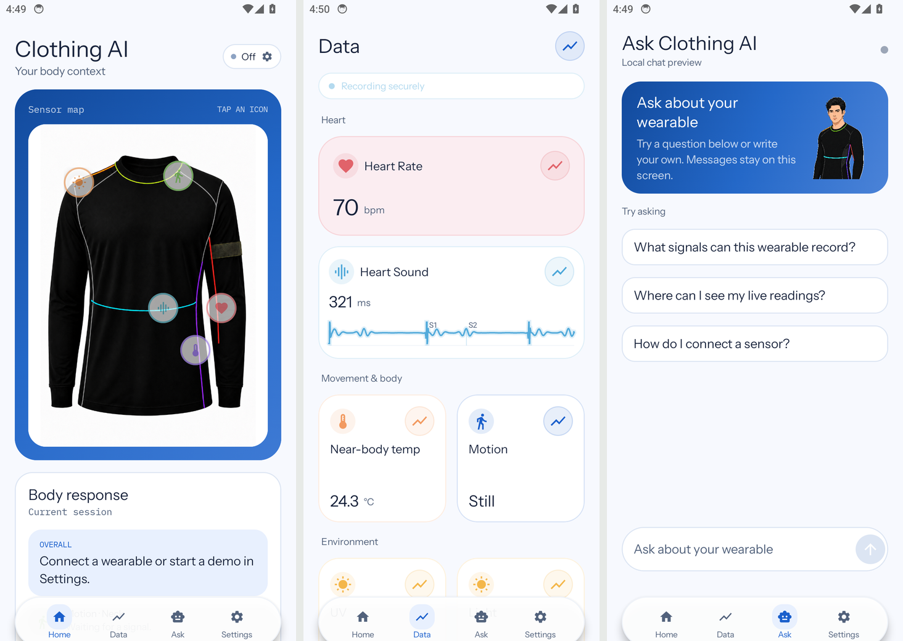

# An Android App for Wearable and Mobile Sensors

Connect a Bluetooth Low Energy sensor to view live waveforms and record data on your Android device. Use **Home** to explore sensor locations, **Data** to inspect live readings and waveforms, and **Settings** to connect a device or choose visible signals. **Ask** is a standalone chat interface. Submitted messages stay in memory for the current session and receive no automatic reply.



*Screens captured on an Android 14 emulator. The Data screen shows signals generated by the built-in demo.*

## Run it

Open the project in Android Studio with JDK 17 and Android SDK 34. Run on Android 8.0 or newer. To run the unit tests and build a debug APK from the command line:

```sh
./gradlew :app:testDebugUnitTest :app:assembleDebug
```

To try it without hardware, open **Settings → Choose another device → Use demo session**, then open **Data**.

## Connect your wearable

The included BLE transport subscribes to the Nordic UART Service TX characteristic. Send UTF-8 sensor frames with a newline after each frame. For example:

```text
T:1000,AX:0,AY:0,AZ:1,TEMP:23.5,ALS:150
```

Here, `T` is device uptime in milliseconds, `AX/AY/AZ` are acceleration in g, and `TEMP` is in °C. Omit fields your device does not measure. Select its advertised name in Settings. For other services or payload formats, adapt [NusBleManager](app/src/main/java/com/wearify/app/ble/NusBleManager.kt) and [SensorParser](app/src/main/java/com/wearify/app/data/SensorParser.kt).

For a different form factor, replace the product image and reposition the five hotspots in [InteractiveSensorMap](app/src/main/java/com/wearify/app/ui/InteractiveSensorMap.kt). To reuse the chat UI, supply a message list and an `onSend` callback to [ChatScreen](app/src/main/java/com/wearify/app/ui/ChatScreen.kt).

## Recordings

Sensor CSVs stay in the app's private `files/recordings/` directory. Android backup is disabled and the app requests no internet permission. To list your own recordings on a debug install:

```sh
adb shell run-as com.wearify.app.community ls files/recordings
```

## License

The app source uses [Apache 2.0](LICENSE). Bundled fonts retain their [SIL Open Font Licenses](app/src/main/assets/licenses/).
